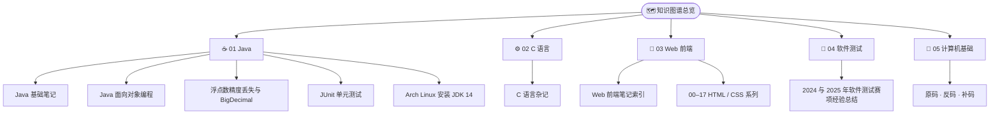
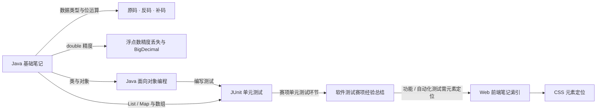

# 知识图谱总览

> [!info] 这是什么
> 这是本笔记库的**知识地图（MOC，Map of Content）**：全库笔记按主题分为 5 个领域，本文是唯一总入口。
> 配套可视化：[[知识图谱.canvas|打开 Canvas 知识图谱]]。
> 在 Obsidian 中按 `Ctrl+G` 打开关系图谱即可看到按领域着色的全库网络（配色分组已配置好）。

## 一、全库结构总览

## 二、按领域索引

### ☕ 01 Java —— 语言基础与工程环境

- [[Java基础笔记]] —— 三大平台、关键字、字面量、变量、进制、数据类型、转换、运算符、数组、List/Map、内存分配、方法、构造方法
- [[Java面向对象编程]] —— 三大特征、类与对象、JavaBean、封装、对象内存图
- [[浮点数精度丢失与BigDecimal]] —— double 精度问题与 BigDecimal 精确计算
- [[JUnit单元测试]] —— JUnit 4/5 断言、生命周期、参数化测试、IDE 配置
- [[ArchLinux安装JDK14]] —— AUR 编译失败 → Oracle deb 包 + debtap 转换安装

### ⚙️ 02 C 语言

- [[C语言杂记]] —— 局部/全局变量与作用域、初始化、`scanf_s`、`extern` 多文件引用、VS 模板文件

### 🎨 03 Web 前端

- [[Web前端笔记索引]] —— 18 篇 HTML / CSS 笔记的目录与学习路线
- HTML：[[01-认识Web与HTML结构]]、[[02-HTML标签基础]]、[[03-HTML标签进阶]]、[[10-表格与表单]]
- CSS 基础：[[00-CSS属性速查表]]、[[04-CSS引入方式与选择器]]、[[05-CSS选择器与字体文本属性]]、[[06-CSS颜色列表与边框属性]]、[[07-背景属性与雪碧图]]
- CSS 布局：[[08-浮动与盒模型]]、[[09-浮动塌陷与元素类型]]、[[11-元素定位]]、[[12-元素居中与定位层级]]、[[13-溢出隐藏与透明度]]、[[14-锚点与宽高自适应]]
- CSS 进阶：[[15-伪元素与最大最小宽高]]、[[16-渐变与过渡]]、[[17-CSS动画]]

### 🧪 04 软件测试

- [[2024与2025年软件测试赛项经验总结]] —— 两年赛项对比、提交文件树、时间分配与得分点、PO 模式结构

### 🔢 05 计算机基础

- [[原码反码补码]] —— 原码弊端、反码跨 0 偏差、补码运算与 `-128`、8 位示例

## 三、跨领域知识关联

关键交叉点：

| 交叉点 | 上游笔记 | 下游笔记 | 关联说明 |
| --- | --- | --- | --- |
| 数据表示 | [[原码反码补码]] | [[Java基础笔记]] | Java 的 byte / short / int / long 取值范围由补码决定 |
| 精度问题 | [[Java基础笔记]] | [[浮点数精度丢失与BigDecimal]] | `float` / `double` 不精确，金额计算改用 BigDecimal |
| 面向对象 | [[Java基础笔记]] | [[Java面向对象编程]] | 基础语法 → 类、对象、封装 |
| 测试 | [[JUnit单元测试]] | [[2024与2025年软件测试赛项经验总结]] | 赛项「单元测试」环节使用的正是 JUnit |
| 前端 | [[Web前端笔记索引]] | [[2024与2025年软件测试赛项经验总结]] | 功能测试 / 自动化测试需要 HTML、CSS 元素定位 |

## 四、标签体系

| 标签 | 含义 | 覆盖笔记 |
| --- | --- | --- |
| `#Java` | Java 语言与生态 | 01-Java 全部 |
| `#C语言` | C 语言 | 02-C语言 |
| `#Web前端` | HTML / CSS | 03-Web前端 全部 |
| `#软件测试` | 测试理论与竞赛 | 04-软件测试、JUnit |
| `#计算机基础` | 计算机底层原理 | 原码反码补码 |
| `#MOC` `#索引` | 地图与目录类笔记 | 本文、Web前端笔记索引 |
| `#HTML` `#CSS` | 前端技术细分 | 03-Web前端 |
| `#单元测试` `#JUnit` | 测试框架 | JUnit单元测试 |

## 五、推荐学习路线

1. **打地基**：[[原码反码补码]] → [[Java基础笔记]]（数据类型、数组、List/Map）
2. **面向对象**：[[Java面向对象编程]] → [[浮点数精度丢失与BigDecimal]]
3. **工程环境**：[[ArchLinux安装JDK14]] → [[JUnit单元测试]]
4. **前端基础**：[[Web前端笔记索引]] 按 01 → 17 顺序学习
5. **横向拓展**：[[C语言杂记]]
6. **实战复盘**：[[2024与2025年软件测试赛项经验总结]]

## 六、统计

| 领域 | 笔记数 | 说明 |
| --- | ---: | --- |
| 01 Java | 5 | 语言基础、面向对象、精度、单元测试、环境 |
| 02 C 语言 | 1 | 变量作用域与 extern |
| 03 Web 前端 | 19 | 18 篇 HTML/CSS + 1 篇索引 |
| 04 软件测试 | 1 | 赛项经验总结 |
| 05 计算机基础 | 1 | 原码反码补码 |
| 00 知识图谱 | 2 | 本页 + Canvas |
| **合计** | **29** | |
