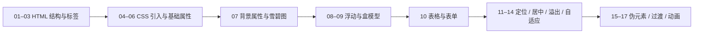

# Web 前端笔记索引

> [!info] 说明
> 本目录收录 18 篇 HTML / CSS 学习笔记，按「HTML 结构 → CSS 基础 → CSS 布局 → CSS 进阶」的顺序编号，建议按序号顺序阅读。

## 学习路线

## 一、HTML 结构与标签（01–03）

- [[01-认识Web与HTML结构]]
- [[02-HTML标签基础]]
- [[03-HTML标签进阶]]

## 二、CSS 基础（00、04–07）

- [[00-CSS属性速查表]] —— 属性速查，可随时回查
- [[04-CSS引入方式与选择器]]
- [[05-CSS选择器与字体文本属性]]
- [[06-CSS颜色列表与边框属性]]
- [[07-背景属性与雪碧图]]

## 三、CSS 布局（08–14）

- [[08-浮动与盒模型]]
- [[09-浮动塌陷与元素类型]]
- [[10-表格与表单]]
- [[11-元素定位]]
- [[12-元素居中与定位层级]]
- [[13-溢出隐藏与透明度]]
- [[14-锚点与宽高自适应]]

## 四、CSS 进阶（15–17）

- [[15-伪元素与最大最小宽高]]
- [[16-渐变与过渡]]
- [[17-CSS动画]]

## 相关笔记

- [[2024与2025年软件测试赛项经验总结]] —— 功能测试与自动化测试都会用到 HTML / CSS 的元素定位知识
- [[知识图谱总览]] —— 返回全库知识地图
